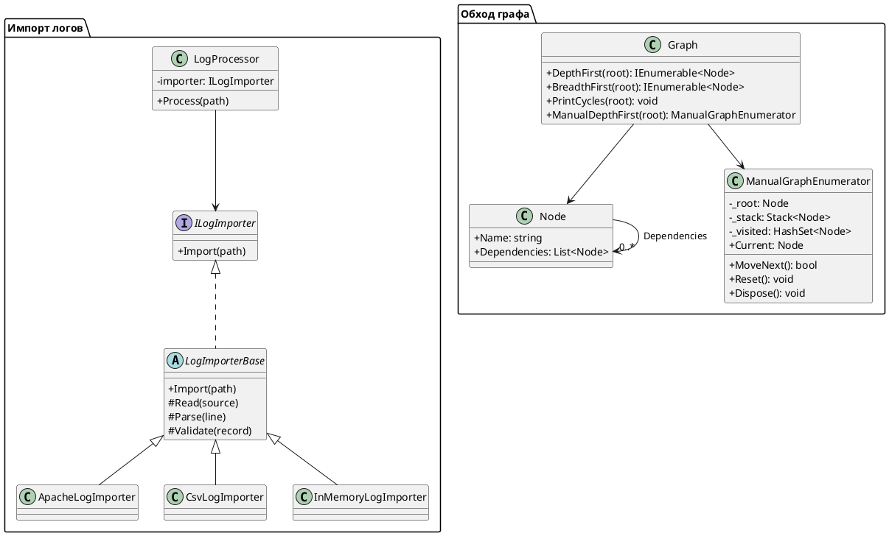

# Лабораторная работа №3. Импорт логов и обход графа

## 1. Цель работы

Изучить применение паттернов проектирования Strategy и Template Method, реализовать импорт логов из нескольких источников, а также освоить обход графов с использованием итераторов в языке C#.

## 2. Постановка задачи

В рамках лабораторной работы необходимо:

1. Реализовать три импортёра логов для разных источников данных.
2. Использовать паттерн Strategy для выбора импортёра во время выполнения программы.
3. Использовать паттерн Template Method для определения общего алгоритма импорта.
4. Реализовать обход графа в глубину (DFS) и ширину (BFS).
5. Обеспечить возможность вложенного использования циклов `foreach`.
6. Реализовать обнаружение циклов в графе с выводом пути цикла.
7. Реализовать ручной итератор и итератор с использованием `yield return`.
8. Написать автоматические тесты для проверки реализации.

## 3. Диаграмма классов

Диаграмма отражает основные классы и интерфейсы проекта, их связи и взаимодействие.



## 4. Применённые паттерны проектирования

В ходе работы были реализованы два паттерна проектирования: Strategy и Template Method.

### 4.1. Strategy

Для реализации паттерна Strategy создан интерфейс `ILogImporter`, определяющий общий контракт импортёров.

Класс `LogProcessor` использует интерфейс `ILogImporter`, получая конкретную реализацию через внедрение зависимостей.

Реализованы три импортёра:

- `ApacheLogImporter` — импорт логов Apache.
- `CsvLogImporter` — импорт данных из CSV-файла.
- `InMemoryLogImporter` — импорт данных из памяти.

Выбор конкретного импортёра выполняется во время запуска программы. Благодаря этому способ импорта можно изменить без изменения логики обработки данных в `LogProcessor`.

### 4.2. Template Method

Для реализации паттерна Template Method создан абстрактный класс `LogImporterBase`.

Он определяет общий алгоритм импорта и последовательность выполнения его этапов. Конкретные импортёры реализуют необходимые операции чтения и разбора данных.

Также предусмотрен метод проверки записи. По умолчанию проверка не ограничивает импорт. Один из импортёров переопределяет этот метод для дополнительной фильтрации записей.

Таким образом, общий алгоритм остаётся единым, а отдельные этапы могут отличаться в зависимости от источника данных.

## 5. Реализация обхода графа

Для представления графа создан класс `Node`.

Каждый узел содержит:
- `Name` — имя узла;
- `Dependencies` — список зависимостей узла.

Класс `Graph` реализует два способа обхода графа: DFS и BFS.

### 5.1. Обход в глубину (DFS)

Метод `DepthFirst` выполняет обход графа в глубину.

Для реализации используются:
- стек `Stack<Node>`;
- множество посещённых узлов `HashSet<Node>`.

Обход начинается с корневого узла. Затем программа последовательно переходит к зависимостям текущего узла.

Множество посещённых узлов предотвращает повторную обработку узлов и бесконечный обход при наличии циклов.

### 5.2. Обход в ширину (BFS)

Метод `BreadthFirst` выполняет обход графа в ширину.

Для реализации используются:
- очередь `Queue<Node>`;
- множество посещённых узлов `HashSet<Node>`.

Сначала обрабатывается корневой узел, затем его зависимости. После этого обрабатываются узлы следующего уровня.

### 5.3. Вложенный foreach

Методы `DepthFirst` и `BreadthFirst` возвращают `IEnumerable<Node>`, поэтому их можно использовать во вложенных циклах `foreach`.

Пример использования:

```csharp
foreach (var service in graph.DepthFirst(root))
{
    foreach (var dependency in graph.BreadthFirst(service))
    {
        Console.WriteLine($"{service.Name} → {dependency.Name}");
    }
}
```

Каждый вызов метода создаёт собственное состояние обхода. Поэтому вложенные циклы выполняются независимо друг от друга.

### 5.4. Обнаружение циклов

Для обнаружения циклов реализован метод `PrintCycles`.

Во время обхода используются:
- множество посещённых узлов;
- множество активных узлов текущего пути;
- список узлов текущего пути.

Если обнаруживается узел, который уже находится в активном пути, программа определяет цикл и выводит последовательность его узлов.

Это позволяет обнаруживать циклические зависимости и выводить путь обнаруженного цикла.

## 6. Реализация итераторов

В лабораторной работе реализованы два варианта итератора.

### 6.1. Ручной итератор

Класс `ManualGraphEnumerator` реализует интерфейс `IEnumerator<Node>`.

В классе реализованы следующие элементы:

- `MoveNext()` — переход к следующему узлу;
- `Current` — получение текущего узла;
- `Reset()` — сброс состояния и повторный запуск обхода;
- `Dispose()` — очистка используемых структур обхода.

Для хранения состояния обхода используются стек и множество посещённых узлов.

### 6.2. Итератор с yield return

В классе `Graph` методы `DepthFirst` и `BreadthFirst` используют `yield return` для последовательного возвращения узлов.

При использовании `yield return` не требуется вручную реализовывать `MoveNext()` и хранить состояние между вызовами.

Компилятор C# автоматически преобразует такой метод во вложенный класс-итератор. В нём создаются поле состояния, метод `MoveNext()` и свойство `Current`.

Поле состояния позволяет сохранять позицию обхода между вызовами `MoveNext()`.

Таким образом, оба варианта итератора возвращают последовательность узлов, но отличаются способом реализации: в ручном варианте состояние управляется программистом, а при использовании `yield return` необходимую механику создаёт компилятор.

## 7. Тестирование

Для проверки реализации созданы автоматические тесты.

По результатам запуска тестового проекта:

- всего тестов — 28;
- успешно выполнено — 27;
- пропущено — 1;
- ошибок — 0.

### 7.1. Проверка импорта логов

Проверяются следующие сценарии:

- изменение результата при замене стратегии импорта;
- последовательность вызова этапов Template Method;
- работа импортёров со стандартной проверкой записей;
- фильтрация записей при переопределении метода проверки.

### 7.2. Проверка обхода графа

Проверяются следующие сценарии:

- правильный порядок обхода DFS;
- правильный порядок обхода BFS;
- возможность использования вложенных циклов `foreach`;
- отсутствие повторной обработки узлов при наличии циклов;
- корректная работа с графом из одного узла;
- совпадение последовательностей ручного итератора и `yield return`;
- обнаружение цикла и вывод его пути.

Дополнительно проверяются:

- повторный запуск ручного итератора через `Reset()`;
- завершение обхода после последнего узла;
- очистка состояния после `Dispose()`;
- обработка общих зависимостей;
- обнаружение зависимости узла от самого себя;
- отсутствие ложного обнаружения циклов в ациклическом графе.

### 7.3. Запуск тестов

Для запуска тестов используется команда:

```bash
dotnet test LogHub.sln
```

Результат выполнения:

```text
Всего тестов: 28
Успешно: 27
Пропущено: 1
Ошибок: 0
Сборка успешно завершена.
```

## 8. Возникшие проблемы и их решение

Во время реализации возникла проблема при использовании метода `Reverse()` для списка зависимостей.

Компилятор выбирал метод `List<T>.Reverse()`, который изменяет исходный список и не возвращает последовательность для перебора.

Проблема была решена использованием `Enumerable.Reverse()`:

```csharp
foreach (var dependency in Enumerable.Reverse(node.Dependencies))
{
    // Обработка зависимости
}
```

Также при реализации обхода графа потребовалось использовать отдельные структуры состояния для каждого вызова обхода. Это позволило корректно выполнять вложенные циклы `foreach`.

Отдельная проверка пустого графа не реализована: методы обхода принимают корневой объект `Node`, поэтому в текущем API обход начинается с переданного узла.

## 9. Вывод

В ходе лабораторной работы были реализованы импорт логов из трёх источников, паттерны проектирования Strategy и Template Method, а также обход графа в глубину и ширину.

Были реализованы обнаружение циклов, вложенное использование циклов `foreach`, ручной итератор и итераторы на основе `yield return`.

Автоматические тесты подтвердили корректность основных сценариев работы программы: 27 тестов завершились успешно, один тест был пропущен, ошибок не обнаружено.

В результате работы были изучены принципы внедрения зависимостей, применения паттернов проектирования и реализации итераторов в C#.

