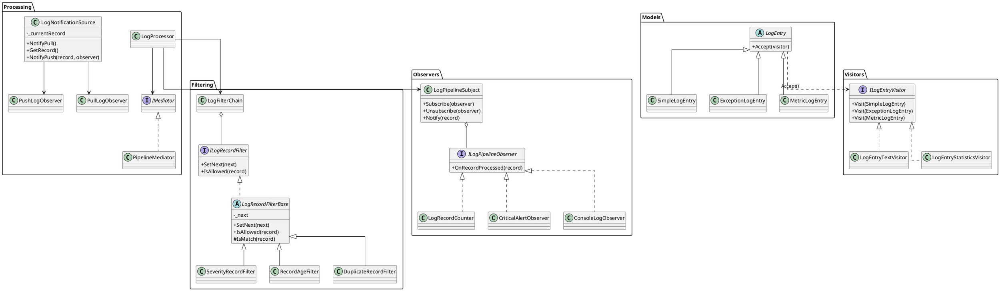

# Лабораторная работа №4
## Поведенческие паттерны проектирования

---

## Цель работы

Реализовать поведенческие паттерны проектирования в системе обработки логов, изучить особенности их применения и проверить корректность работы с помощью автоматических тестов.

В работе рассматриваются следующие паттерны:

- **Chain of Responsibility** — цепочка обязанностей;
- **Visitor** — посетитель;
- **Observer** — наблюдатель;
- **Mediator** — посредник.

Дополнительно рассматриваются модели передачи данных **Push** и **Pull**.

---

## 1. Диаграмма классов конвейера

На диаграмме представлены основные компоненты системы обработки логов, их интерфейсы и связи между ними.

**Описание диаграммы:**

- `LogProcessor` выполняет обработку записей и взаимодействует с фильтрами, наблюдателями и посредником.
- `LogFilterChain` организует последовательную работу фильтров.
- `LogEntry` и его наследники представляют различные типы записей.
- `ILogEntryVisitor` определяет операции для обработки разных типов записей.
- `LogPipelineSubject` управляет подписчиками и отправляет им уведомления.
- `PipelineMediator` координирует взаимодействие компонентов при перегрузке очереди.
- `LogNotificationSource` демонстрирует передачу данных по моделям Push и Pull.

---

## 2. Реализация паттернов проектирования

### 2.1. Chain of Responsibility — цепочка обязанностей

Для фильтрации записей реализована цепочка обработчиков. Каждый фильтр выполняет собственную проверку и передаёт запись следующему фильтру, если условие выполнено.

**Реализованные фильтры:**

| Класс | Назначение |
|---|---|
| `SeverityRecordFilter` | Проверяет минимальный уровень серьёзности записи |
| `RecordAgeFilter` | Проверяет возраст записи |
| `DuplicateRecordFilter` | Исключает повторяющиеся записи |

Порядок фильтров задаётся конфигурацией.

**Особенности реализации:**

- Порядок фильтров можно изменять.
- Пустая цепочка пропускает все записи.
- Новые фильтры можно добавлять без изменения существующих.

**Обоснование выбора:** паттерн позволяет гибко настраивать обработку записей и расширять систему без изменения уже реализованных фильтров.

### 2.2. Visitor — посетитель

Для обработки различных типов записей реализован паттерн Visitor.

В системе используются три типа записей:

- `SimpleLogEntry` — обычная запись.
- `ExceptionLogEntry` — запись об исключении, содержащая StackTrace.
- `MetricLogEntry` — запись с числовым значением метрики.

Создан интерфейс `ILogEntryVisitor`, содержащий отдельный метод `Visit` для каждого типа записи.

**Реализованные посетители:**

- `LogEntryTextVisitor` — формирует текстовое представление записей.
- `LogEntryStatisticsVisitor` — собирает статистику по количеству записей каждого типа.

Для выбора соответствующего метода используется **двойная диспетчеризация** через метод `Accept`, переопределённый в конкретных классах записей.

**Обоснование выбора:** Visitor позволяет добавлять новые операции над объектами, не изменяя классы самих записей.

### 2.3. Observer — наблюдатель

Для уведомления компонентов об обработке записей реализован паттерн Observer.

Интерфейс `ILogPipelineObserver` определяет метод `OnRecordProcessed`, который вызывается после обработки записи.

**Реализованные наблюдатели:**

| Класс | Назначение |
|---|---|
| `LogRecordCounter` | Подсчитывает количество обработанных записей |
| `CriticalAlertObserver` | Реагирует на записи критического уровня |
| `ConsoleLogObserver` | Выводит информацию о записи в консоль |

Класс `LogPipelineSubject` управляет подписчиками и предоставляет методы:

- `Subscribe` — подписка на уведомления;
- `Unsubscribe` — отписка от уведомлений;
- `Notify` — рассылка уведомлений.

Исключения отдельных наблюдателей перехватываются, поэтому ошибка одного подписчика не мешает уведомлению остальных.

**Обоснование выбора:** Observer позволяет уведомлять несколько независимых компонентов об одном событии и добавлять новых подписчиков без изменения основного процесса обработки логов.

### 2.4. Mediator — посредник

Для координации взаимодействия компонентов реализован паттерн Mediator.

Класс `PipelineMediator` управляет состоянием перегрузки очереди обработки логов.

**Основные функции:**

- При перегрузке очереди импортёр приостанавливает добавление новых записей.
- После уменьшения очереди импортёр продолжает работу.
- Взаимодействие компонентов выполняется через посредника.

**Обоснование выбора:** Mediator уменьшает связанность компонентов и централизует управление их взаимодействием.

---

## 3. Сравнение моделей Push и Pull

В системе реализованы две модели передачи данных.

| Критерий | Push | Pull |
|---|---|---|
| Передача данных | Источник передаёт запись сам | Наблюдатель запрашивает запись |
| Инициатор получения | Источник | Наблюдатель |
| Получение записи | Непосредственно при уведомлении | Через делегат `Func<LogRecord?>` |

### Push

Источник самостоятельно передаёт запись наблюдателю через метод `OnRecordProcessed(record)`.

Наблюдатель сразу получает данные и может обработать их.

### Pull

Источник уведомляет наблюдателя о событии. После этого наблюдатель самостоятельно запрашивает текущую запись через делегат `Func<LogRecord?>`.

### Вывод по сравнению

Главное различие заключается в том, кто инициирует получение данных:

- **Push** — источник сам отправляет данные.
- **Pull** — наблюдатель самостоятельно запрашивает данные после уведомления.

Обе модели проверяются на одинаковых входных данных. Это позволяет убедиться, что при одинаковых условиях они дают одинаковый результат.

---

## 4. Обоснование выбора паттернов

| Паттерн | Причина использования |
|---|---|
| **Chain of Responsibility** | Последовательная фильтрация записей с возможностью изменения порядка фильтров |
| **Visitor** | Добавление новых операций над типами записей без изменения их классов |
| **Observer** | Уведомление нескольких подписчиков об обработке записей |
| **Mediator** | Централизованная координация компонентов и управление перегрузкой очереди |

Использование данных паттернов позволяет разделить ответственность между компонентами, уменьшить связанность и упростить расширение системы.

---

## 5. Тестирование

Для проверки корректности реализации созданы автоматические тесты.

**Проверяемые сценарии:**

1. Фильтр уровня серьёзности отклоняет неподходящие записи.
2. Фильтр возраста отклоняет устаревшие записи.
3. Фильтр дубликатов исключает повторяющиеся записи.
4. Пустая цепочка пропускает все записи.
5. Изменение порядка фильтров влияет на результат обработки.
6. Добавление нового Visitor не требует изменения классов записей.
7. Каждый Visitor получает соответствующий тип записи.
8. Отписанный наблюдатель перестаёт получать уведомления.
9. Исключение одного наблюдателя не мешает работе остальных.
10. Push и Pull возвращают одинаковые результаты на одинаковых данных.
11. Проверяется подсчёт обработанных записей.
12. Проверяются дополнительные сценарии обработки.

**Результат:** все 12 автоматических тестов пройдены успешно.

---

## 6. Вывод

В ходе лабораторной работы были реализованы поведенческие паттерны проектирования **Chain of Responsibility, Visitor, Observer и Mediator**.

Также были реализованы и сравнены модели передачи данных **Push и Pull**.

В результате получена расширяемая система обработки логов, в которой фильтрация, обработка записей, уведомление подписчиков и координация компонентов разделены между отдельными объектами.

Корректность реализации подтверждена успешным прохождением **12 автоматических тестов**.
